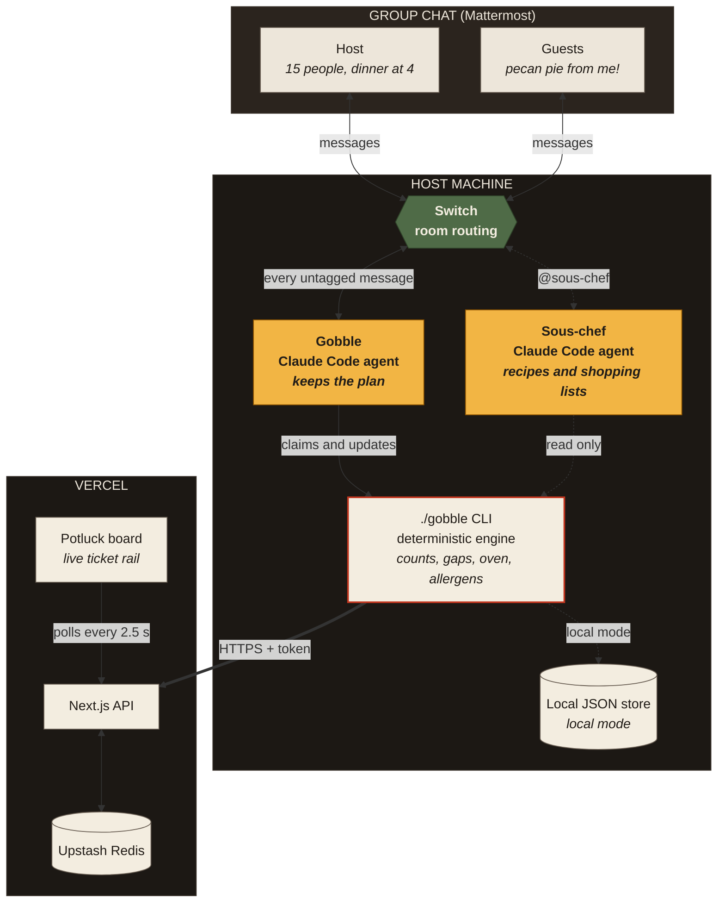

# Gobble

Every dish gets an owner.

Gobble is a potluck organizer that lives in your group chat. Guests say what they're bringing in plain words. Gobble keeps the list, checks it against the headcount, diets, allergies and the oven, and asks the right person about each gap until the plan is complete. Then it posts who's bringing what.

Built for the WeMakeDevs **Flip the Switch** hackathon on [Switch](https://docs.switchagents.ai/).

| Link | Where |
|---|---|
| Demo video and write-up | https://rofyray.github.io/gobble/ |
| Site | https://gobble-board.vercel.app |
| Live board (finished plan) | https://gobble-board.vercel.app/e/demo |
| Mid-plan board | https://gobble-board.vercel.app/e/demo-mid |
| Code | https://github.com/rofyray/gobble |

[](https://rofyray.github.io/gobble/)

## How Switch is used

- Gobble and Sous-chef are Claude Code agents in a Switch room on Mattermost.
- `!assign-agent @gobble` routes every untagged message to Gobble, so guests never need commands.
- The room is defined in `switch/gobble-room.template.yaml`: agents, addressing, room instructions and kickoff.
- Gobble hands off to Sous-chef inside the same room after the plan is locked.

Without Switch, Gobble has no room, no people and no routing.

## How it works



1. Gobble reads each message and turns claims into `./gobble` CLI calls.
2. The CLI runs a deterministic reconciliation engine (`lib/engine`) that finds unclaimed dishes, shortfalls, doubles, uncovered diets, allergen conflicts and oven clashes.
3. Gobble resolves fresh conflicts first, otherwise asks about the top gap, @mentioning specific people.
4. The Potluck Board (Next.js on Vercel) polls the same plan and shows it as a kitchen ticket rail.

The language model handles the chat. The engine does the counting, so every gap Gobble raises is real and every "done" is earned.

## Run it yourself (about 10 minutes)

Requirements: Node 22+, pnpm, Docker, Switch Console, Claude Code.

```bash
git clone https://github.com/rofyray/gobble.git && cd gobble
pnpm install
pnpm dev                                   # board at http://localhost:3000
cp agents/gobble/.env.example agents/gobble/.env
cp agents/sous-chef/.env.example agents/sous-chef/.env
```

1. In Switch Console, set up a local server and sign in to Claude Code.
2. Go to Templates, choose Import template, paste `switch/gobble-room.template.yaml`, click Use, and set the repo folder.
3. In the new room, send `!assign-agent @gobble`.
4. Say "@gobble 15 people Thursday, dinner at 4, I've got the turkey."

No Vercel or Redis is needed locally: the CLI and the board share a JSON store in `.gobble-data/`.

You can also drive the plan by hand, the same way the agent does:

```bash
cd agents/gobble
./gobble init --title "Thanksgiving at Rofy's" --date 2026-11-26 --dinner 16:00 --headcount 15 --host rofy --pretty
./gobble claim kia dessert --item "Pecan pie" --tags contains-tree-nuts
./gobble status --pretty
```

To deploy:

1. Import the repo in Vercel.
2. Add Upstash Redis from the Vercel Marketplace.
3. In Vercel, set `GOBBLE_AGENT_TOKEN` and `NEXT_PUBLIC_SITE_URL`, then deploy.
4. In both `agents/gobble/.env` and `agents/sous-chef/.env`, set `GOBBLE_API_URL` to your Vercel URL and `GOBBLE_AGENT_TOKEN` to the same token.

## Tests

```bash
pnpm test        # engine rules + CLI scenario
pnpm test:e2e    # board smoke test
```

## Stack

TypeScript, Next.js, Tailwind, Zod, Upstash Redis, Vercel, Switch, Claude Code, Mattermost.

## License

MIT
